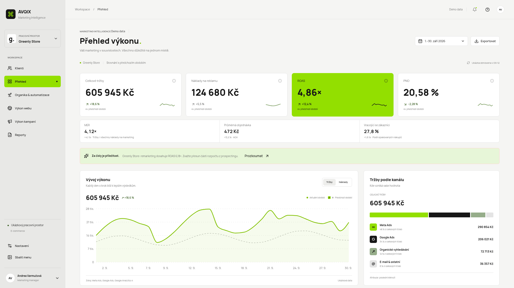

# AVQIX · Marketing Intelligence

**Živé demo: https://andrea-intelligence-studio.vercel.app**
*(ukázkový pracovní prostor, všechna čísla jsou vymyšlená demo data)*



AVQIX je přehledový nástroj pro marketingové řízení: na jednom místě ukazuje, jak si vedou reklamy, web, organika a e-maily u jednotlivých klientů, a převádí čísla do srozumitelných doporučení. Vzniká jako osobní pracovní prototyp (Andrea Varmužová, performance marketing) a je postavený tak, aby šel postupně napojit na skutečné zdroje dat bez přepisování aplikace.

## Rychlý start

Jeden příkaz, vše ostatní se stáhne samo (potřebujete jen [Node.js](https://nodejs.org)):

```sh
gh repo clone varmuzovaa-source/andrea-intelligence-studio && cd andrea-intelligence-studio && ./start.sh
```

Už máte kód stažený? Stačí `./start.sh`. Otevře se aplikace a můžete rovnou kliknout na „Vyzkoušet na vymyšlených datech“ na stránce Search Console.

## Nové: Search Console a Datové zdroje

- **Search Console** (`/search-console`): nahrajete CSV export (česky i anglicky), aplikace rozpozná dotazy a stránky a ukáže **příležitosti**: hodně zobrazení s nízkým CTR, pozice 8 až 20 a poklesy proti předchozímu období. K tomu pravidlová doporučení s prioritou a jistotou.
- **Datové zdroje** (`/datove-zdroje`): karty konektorů (Search Console, Meta Ads, Google Ads, GA4, YouTube, e-mailing, AI) jako zásuvné moduly. Všechny jsou zatím Nepřipojeno. U každého jde nahrát CSV a aplikace ukáže, které sloupce se našly a které chybí.
- **AI (Claude, GPT)**: vypnutá ve výchozím stavu. Po zapnutí jen ukáže náhled souhrnných čísel, která by se poslala. V prototypu se nic neodesílá.
- **Soukromí:** soubory se čtou jen v prohlížeči, data zůstanou v paměti a po obnovení stránky zmizí.

## Co už funguje (demo)

- **Čtyři demo klienti, čtyři obchodní modely:** e-commerce, služby (lead generation), hybrid a B2B. Každý model má vlastní sadu KPI, slovník a doporučení, takže stejná aplikace dává smysl pro e-shop i pro klinku.
- **Přehled:** tržby, náklady na reklamu, ROAS, PNO, MER, průměrná objednávka a podíl vracejících se zákazníků, vždy v porovnání s předchozím obdobím. ROAS se počítá z celkových tržeb a nákladů, nikdy průměrem procent.
- **Organika & automatizace, Výkon webu, Výkon kampaní, Reporty.**
- **Kampaně:** tabulky s vyhledáváním, řazením, filtry, stránkováním, výběrem sloupců a exportem do CSV, k tomu náhledy kreativ.
- **Doporučení** podle klienta (pravidlová analýza, ne generativní AI) s odůvodněním, prioritou a odhadovaným dopadem.
- **Reporty** pro interní použití i pro klienta, export do CSV.

## Co je jen ukázka

Žádný zdroj dat není připojený. Čísla se generují přímo v kódu (`src/lib/analytics-data.ts`) a v aplikaci jsou označená „Demo data". Nic se neukládá do databáze, není přihlášení ani uživatelé a aplikace nic neposílá ani nemění v žádných reklamních účtech.

## Kam to směřuje

1. **Skutečné připojení účtů** (Search Console, Meta Ads, Google Ads, GA4, YouTube, e-mailing) místo ručního CSV. Zatím není.
2. **Import CSV i u ostatních zdrojů** tak, aby data skutečně vstupovala do přehledů (dnes jen kontrola sloupců).
3. **Zapojení AI** (Claude, GPT) s vlastním klíčem, stále vypnuté ve výchozím stavu a jen se souhrnnými čísly.
4. **Soukromí na prvním místě:** reálná data zůstávají lokálně a produkční adresa se zamyká ochranou přístupu.

## Technologie

TanStack Start (React, TypeScript), Tailwind CSS, Recharts, Vitest. Hostováno na Vercelu, každý push do větve `main` se nasadí automaticky (`vercel.json` přepíná build na Vercel).

## Spuštění lokálně

```sh
./start.sh       # nainstaluje a spustí
npm run dev      # jen vývojový server
npm test         # testy
npm run build    # produkční build
```

## Dokumentace

- [Roadmapa](roadmap.md)
- [Původní designový záměr](docs/design-brief.md)

Původně vytvořeno v [Lovable](https://lovable.dev), dál vyvíjeno v repozitáři.

## Cíle a rady + most z Fachmana (zdarma, lokálně)

**Cíle a rady** (`/cile`): zadáte obchodní cíl, marketingový cíl a čísla (KPI) s cílovou hodnotou a obdobím. Aplikace ukáže, jak daleko jste, a řekne, co udělat u konkrétní kampaně. Tlačítko **Předat** vytvoří úkol. Tlačítko **Zkopírovat pro Fachmana** vyrobí řádky `- KPI: ROAS ≥ 5 × · 30 dní · vše`, které vložíte do části „2. Cíle (KPI)“ souboru `ppc.md` klienta. **Načíst z ppc.md** je přečte zpět.

**Skutečná čísla (most):**
1. Jednorázově musí být nastavený Fachman (`~/AGENTURA/PPC`, složka `.venv`, soubor `.env`). To dělá Fachman sám, AVQIX `.env` nikdy nečte.
2. Ve složce AVIX spusťte:
   ```bash
   python3 scripts/most_fachman.py <klient> --google 123-456-7890 --meta act_123456 --dny 30
   ```
   (stačí jen `--google` nebo jen `--meta`; období 7, 30 nebo 90). Skript spustí Fachmanovy čtecí skripty a uloží soubory do `data-most/` (složka je v `.gitignore`).
3. V AVQIX: **Datové zdroje → Fachman → Vybrat soubory z data-most**. Data žijí jen v paměti prohlížeče a po obnovení stránky se smažou.

Fachmana skript nijak nemění a nic nikam neposílá. Zatím se čtou kampaně z Google Ads a Meta Ads; e-mailing (ActiveCampaign aj.) zatím data nemá.

**Vlastní klient:** na stránce **Klienti → Přidat klienta** zadáte název a typ podnikání. Klient začíná prázdný (žádná vymyšlená čísla), vidí jen Cíle a rady, Úkoly týmu, Search Console a Datové zdroje. Ukládá se jen v tomto prohlížeči. Na stránce Cíle a rady je pro něj hotový příkaz pro Fachmana.

**Aktualizace jedním klikem:** když appku spustíte přes `./start.sh` (nebo `Spustit-AVQIX.command`), na stránce Cíle a rady u vlastního klienta je tlačítko **Aktualizovat z Fachmana**. Doplňte ID účtů, klikněte a čísla se stáhnou přes Fachmana a načtou sama. Endpoint `/api/most` funguje jen s proměnnou `AVQIX_LOCAL=1` a jen z localhostu, na Vercelu je vypnutý.
